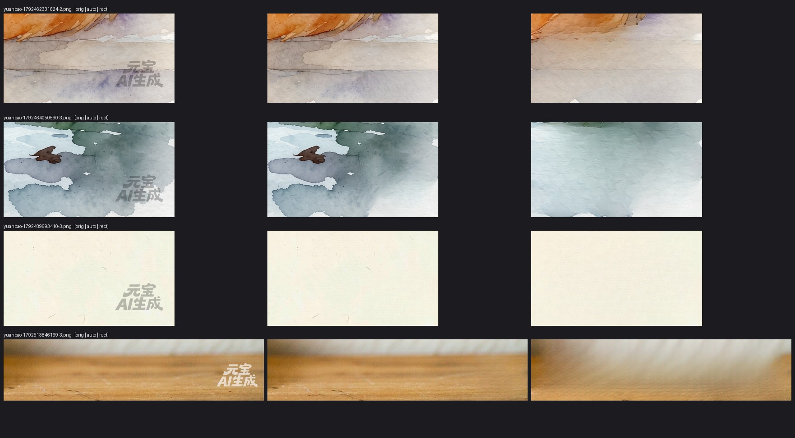

# dsh-yuanbao-t2i

[](https://github.com/lm846802297-bit/dsh-yuanbao-t2i/releases/latest)
[](LICENSE)
[](https://github.com/lm846802297-bit/dsh-yuanbao-t2i/actions/workflows/ci.yml)

> 当前版本 **v0.10.0**（⚡ **破坏性变更**：撤下 `wmMask`「修复范围」开关——掩膜改由插件**内部自适应**（`auto`，检出不可信时自动降级整块重绘），只留环境变量 `DSH_WM_MASK` 兜底。上一版 v0.9.0 移除 `seed` 参数——元宝协议层没有 seed 落点，留着只会让人以为能复现）

> ⚡ **v0.9.0 破坏性变更：`seed` 参数已移除**。它本来就**没有任何作用**（只是把值原样回显），但如果你在脚本/提示里传了 `seed`，升级后会被**参数校验拒绝**（报未知参数）。**处理方式：把 `seed` 从调用里删掉即可**，其余参数与行为完全不变。

> ⚡ **v0.10.0 破坏性变更：`wmMask`（「修复范围」）参数与界面选项已撤下**。掩膜改为插件**内部自适应**：默认在「只修字形」与「整块矩形重绘」之间自动选路，检出不可信时自动降级为整块重绘，修完还有**残痕自检**兜底——不再需要你来选（自适应、降级保护与自检都还在）。两条影响：① 脚本/提示里传了 `wmMask` ⇒ 升级后会被**参数校验拒绝**（报未知参数）；② 旧配置文件里遗留的 `wmMask` ⇒ 被**静默忽略**（不报错、不迁移、不回写）。**处理方式：把 `wmMask` 从调用里删掉、界面不用再管即可**，其余参数与去水印行为不变。

> 🚨 **如果你装的是 v0.8.0 或更早，请升级到 v0.8.1**：v0.8.0 及更早版本里，工具入口调用去水印时漏传了日志回调，去水印会**静默失败**——调用返回 `ok: true`，但拿到的仍是**带水印的原图**（宿主日志里只有一行 `去水印失败（保留原图继续）：log is not a function`）。v0.8.1 已修好，并新增返回字段 `watermarkError`：一旦去水印没生效，会在返回值与界面提示里**明说**，不再假装成功。

> ⚠️ **v0.8.0 新增**：`style` 参数（画风预设）+ `yuanbao_t2i_styles` 工具（列出/检索画风）。原有参数与行为**未变**。

> ⚠️ **v0.7.0 有行为变化**：默认 `imageRatio: "16:9"` 从「写进提示词的软生效」变成**真比例** ⇒ 默认出图尺寸从 `1344×1792`（3:4）变成 `2240×1248`（2K 16:9）。若你依赖旧的竖版默认，改传 `imageRatio: "3:4"`。
>
> 🚨 **如果你装的是 v0.6.0，请直接升级到 v0.7.0**：v0.6.0 有取图回归（`bodyText.split("\\n")` 写成了字面反斜杠），**SSE 解析恒为 0 张**，即「调用成功但一张图都拿不到」。v0.6.1 修好了它，v0.6.2 又修掉了上传时弹系统「打开」文件框不关闭的问题。升级步骤见 <a href="#安装">安装</a> 一节（`git pull && npm install` 后重载插件即可）。
>
> 🚨 **如果你装的是 v0.5.0 或更早**：v0.5.0 已下架 `telea` 引擎（只保留 `lama`），配置文件里的 `wmEngine: "telea"` 会被**静默**改写成 `lama`（不报错），请知悉。

[DSH](https://github.com/deepseek-ai)（DeepSeek Harness）本地插件：用**腾讯元宝网页版**（混元 Hy Image）**文生图 / 图生图**，一次 4 张 PNG 直接落盘，**输出比例/分辨率真可控**（v0.7.0 起走元宝「AI 生图」模式的真实控件），**画风可直接套用元宝官方模板库**（v0.8.0 起，1000+ 条画风模板），并可在插件设置卡里选择图片存到哪个目录（**v0.5.1 起支持点按钮选目录**，不用手敲长路径）、是否去水印（**v0.10.0 起修复范围不再是开关**，掩膜由引擎内部自适应）。

> ⚠️ **性质说明**：本插件通过 [patchright](https://github.com/Kaliiiiiiiiii-Vinyzu/patchright) 驱动真实浏览器登录元宝网页版，复用**你自己账号**的会话。请自行评估账号风险（频繁调用、自动化行为可能触发平台风控），并遵守腾讯元宝的服务条款。作者不对账号受限、图片内容或版权负责。


<sub>上半＝整图对比，下半＝右下角 2× 放大（引擎内部自适应掩膜）。默认**不去水印**；开启后可去掉右下角「元宝 AI生成」，但放大仍能看到轻微平滑／修补痕（纸纹、白底类画面更明显）——所以默认关。掩膜两条路径（只修字形 / 整块矩形）的实测差别见下节 <a href="#内部自适应掩膜">内部自适应掩膜</a>。</sub>

## 它做什么

- 工具名 `yuanbao_t2i`：传中文提示词 → 弹出/复用浏览器 → 走 `yuanbao.tencent.com` 的 `/api/chat/` SSE，从 `type=replace` 帧的 `multimedias[]` 取图 → 裸 `fetch` 下载 → 落盘 PNG。
- 传 `refImages`（本地文件 / URL / 文件夹，≤5 张）即走**图生图**：参考图由**元宝前端自己上传**（插件只负责把文件交给浏览器的上传控件），插件**不做任何签名**。
- 传 `style`（画风预设名）即**套用元宝官方模板库的画风**：模板库里 1000+ 条 `image2image` 模板，正文就是完整的画风描述（板绘/复古/野兽派/工笔重彩…），插件会把它剥好比例与指令前缀后追加到你的提示词后，并按模板自带的比例设定比例控件。
- 首次使用需**微信扫码登录**一次，登录态存在本地 profile 目录，之后复用。
- 同一个 profile 不能被两个浏览器同时打开，所以插件内部把所有调用**串行化**。
- 右下角「元宝 AI生成」水印可选去除，只用 `lama`（Big-LaMa 深度模型）。**默认不去水印**——实测 LaMa 在纸纹/白底图上仍有轻微平滑痕，看用途决定。（`telea` 引擎已于 v0.5.0 下架，理由见下文「为什么没有接入 MAT / ZITS」。）
- `lama` 的**修复范围不再由用户选**（v0.10.0 撤下该开关）：引擎内部**自适应**（`auto`）——先按「位置先验 + 局部中值背景 + MAD 阈值」紧贴字形检出，膨胀后只修字形；检出**不可信**（命中率落在 [0.5%, 25%] 之外）时自动降级为整块矩形重绘，修完还会用同一套检测对输出图**自检残痕**，残留超标就用整块重绘兜底。实测两条路径差别很大——整块重绘在插画上会把窗口/砖石/水彩洗边糊掉，只修字形只留一道淡淡的修补痕。排障要强制某一档时可设环境变量 `DSH_WM_MASK=tight|rect`，平时不用管。

## 内部自适应掩膜

掩膜模式（`tight` / `rect`）**v0.10.0 起是引擎内部实现、不再是用户开关**：默认 `auto` 在两者间选路，只有环境变量 `DSH_WM_MASK` 能强制。下面这张表是两条路径的实测差别（也是 `auto` 的选路依据），只影响 `lama` 引擎重修多大一块：

| 模式 | 行为 | 实测（右图哥特城，1872×1248） |
| --- | --- | --- |
| `tight`（只修字形） | 在 ROI 内**自适应**检出字形（位置先验 + 局部中值背景 + MAD 阈值，见下节），膨胀 ~25px 后**只修字形**，再按羽化掩膜回填 | 改动 **0.63%** 像素（14,644 px）；砖缝／窗框／屋顶轮廓全部保留，只在水印原处留一道很淡的修补痕 |
| `rect`（整块重绘） | 把 ROI 整块矩形交给 LaMa 重建 | 改动 **1.85%** 像素（43,321 px，约 3 倍）；塔身右侧一大片被抹平成雾状，窗户与尖顶细节丢失 |


**结论**：`auto` 默认走 `tight`（只修字形），绝大多数图用它就对了。`auto` 的判据是**命中率可信区间**：紧贴字形的检测命中率落在 [0.5%, 25%] 之外（低于＝没检出字、高于＝把背景当字），就自动降级 `rect`（整块重绘，重修面积变大）；修完还有一道**残痕自检**（用同一套检测重跑输出图，残留超 `max(0.4%, 35%×原始命中)` 就用 `rect` 重修）。这些降级都是自动的，不需要你选。排障时想固定某一档，用环境变量 `DSH_WM_MASK=tight` / `rect`（见「环境变量」一节）。

### tight 为什么能自适应

元宝水印是**半透明白**叠加：压在暗背景上是一圈**亮笔画**，压在白纸上则变成**暗笔画**（只比纸暗 3–9 个灰度级）。固定绝对阈值必然一头踩空——实测 `thr=185` 在纯白图上命中 **100%** 的 ROI，等于把整块背景当字形抹平（ROI 内 3.85%–9.51% 像素被改，文字上方的空白带 21.3% 被改）。

所以 `tight` 的检出必须**自适应**。v0.10.0 起的口径（`lib/wm_lama.py` v2 检测器）＝**位置先验 + 局部中值背景 + MAD 阈值 + 低饱和闸**：

- **位置先验**：只在水印真正会出现的那块 ROI（`PRIOR_BOX`）里判定，别处不参与 ⇒ 不碰画面其余部分；
- **局部中值背景**：每个像素跟它周围 `MED_K=41` 邻域的中值比，而**不是**跟全图比 ⇒ 纸纹／渐变背景不再被误当字形；
- **MAD 阈值**：偏离门槛取 `max(6, 2.5×MAD)`，随图自身噪声水平浮动（噪声大的水彩图门槛自动抬高）；
- **低饱和闸**：彩色像素不参与（水印是灰白叠加）。
- 命中率落在 `[MIN_HIT, MAX_HIT]`（`0.5%`–`25%`）之外 ⇒ `auto` 自动降级 `rect`；修完再用**同一套**检测跑一遍输出图做**残痕自检**（残留 ≥ `max(0.4%, 35%×原始命中)`）就用 `rect` 兜底重修。

**v0.10.0 实测（20 张真样本）**：`auto` 无一张降级，ROI 改动面积**均值 9.41%**，而强制 `rect` 是 **54.07%**（少 5.7 倍）；肉眼复核水彩／木纹／带鸟的水彩三类：`auto` 水印消失且纹理完好，`rect` 整块糊掉。



> 📌 **以下为历史读数，仅存档**：v0.8.1–v0.9.0 用的是**分位数检测器**（口径＝「ROI 亮度分布两端各出一候选：亮笔画 `p99.5−12`、暗笔画 `p0.5+12`，只有两端都检出才取命中面积更小的一端」）。该口径已于 v0.10.0 被上文的 v2 检测器取代——因为它出过一次真事故（见下方 v0.8.1 说明），且回归锁 ⑨ 现在**禁止代码里再出现分位数**。16 张样本实测（旧口径）：

| 样本类型 | 固定 thr=185 | 自适应 |
| --- | --- | --- |
| 4 张白底宣纸图（ROI p50≈243） | 命中 97%–98%，背景被抹平 | 自动切**暗笔画**，命中 2.2%–3.0%，水印清掉、纸纹保留（背景区 std 7.99 → 7.89） |
| 4 张纯白/近白图（ROI p50≥230） | 命中 82%–100% | 命中 0.0%–2.6% |
| 8 张深底/水彩图 | 命中 0%–43% | 命中 0.6%–3.0%（无回归） |
| 全样本 ROI 平均改动面积 | 19.5% | **8.4%** |

> ⚠️ **v0.8.1 修正了「盲选空端」的缺陷**：v0.8.0 及更早是「取命中面积更小的一端」，于是当某一端命中 0 时会盲选那个**空**端 ⇒ 掩膜为空 ⇒ 退回 `rect` ⇒ 整块 ROI 被重绘。2026-10-21 在 22 样本回归里实测到一张彩色图：暗端命中 0%、亮端命中 4.2%，旧逻辑选中空端 ⇒ ROI 内 96.4% 像素被改（其中 diff>20 占 50.7%）；修正后该图 ROI 内 diff>20 降到 **3.11%**、纹理保留比从 0.30 升到 0.48，**其余 21 张逐位一致**。另外补上了「选中端自身命中超 ROI 60% ⇒ 降级 rect」的保护。

## 示例

| 文件 | 内容 |
| --- | --- |
| [`examples/prompts.md`](examples/prompts.md) | 提示词模板：场景 BG / 角色立绘 / CG / 水彩 / 图标，含「加什么词能得到什么」对照 |
| [`examples/profile-setup.md`](examples/profile-setup.md) | 挂载到 DSH profile 的完整步骤（package.json、junction、cordis.patch.yml、验证与排错） |
| [`examples/settings.json`](examples/settings.json) | 插件设置文件（`~/.dsh/yuanbao-t2i-config.json`）示例 |

## 安装（DSH 本地插件）

插件是 DSH 的 **bundle + dual-face 包**（宿主半 `lib/plugin.js`，浏览器半 `client.js`）。装法：

1. 把本仓库放到 DSH profile 的 `vendor/` 下，例如
   `C:/Users/<你>/.dsh/profiles/desktop/vendor/yuanbao-t2i`
2. 装依赖：`npm install`（只依赖 `patchright@1.62.3`；首次运行会自行下载 Chromium）
3. 在 profile 的 `package.json` 里登记依赖与 bundle：
   ```json
   {
     "dependencies": { "dsh-yuanbao-t2i": "link:vendor/yuanbao-t2i" },
     "dsh": { "profile": { "bundles": ["dsh-yuanbao-t2i"] } }
   }
   ```
4. 把包链接进 profile 的 `node_modules`（Windows 可用 junction）：
   `mklink /J node_modules\dsh-yuanbao-t2i ..\vendor\yuanbao-t2i`
5. 重启 DSH Desktop（或在 Settings → Plugins 里把本插件关掉再打开）让它加载新的宿主半和浏览器半。

> 💡 **v0.5.1 起新增**：设置卡里「输出目录」旁边多了个**「选择目录…」**按钮，点一下弹 Windows 文件夹选择器，选完自动填进输入框（详见下文「插件界面（设置卡）」）。升级到 v0.5.1 只需 `git pull` + `npm install` + 重载 DSH，老配置文件完全兼容。

### 升级已有安装

已经装过的（仓库就在 `vendor/yuanbao-t2i` 目录下）**直接原地升级**，不需要重新 clone、也不需要重做 junction：

```bash
cd <你的>/.dsh/profiles/<profile>/vendor/yuanbao-t2i
git pull
npm install
```

然后在 DSH 里**重载插件**（Settings → Plugins 里把本插件关掉再打开，或重启 DSH Desktop）即可生效 —— profile 的 `node_modules/dsh-yuanbao-t2i` 是指向 `vendor/yuanbao-t2i` 的链接/junction，代码改动即时可见，只有**依赖变化**才需要重跑 `npm install`。

> ⚡ **v0.9.0 用户必读**：`seed` 参数已删除（协议层无落点，见「已知限制」）。调用里带 `seed` 会报未知参数，删掉即可。
> 🚨 **v0.6.0 用户必读**：v0.6.0 的取图有回归（`bodyText.split("\\n")` 写成了字面反斜杠），**SSE 解析恒为 0 张** —— 调用「成功」但一张图都拿不到。请升到 **v0.6.2**（v0.6.1 修了取图，v0.6.2 修了上传时弹系统「打开」文件框不关闭）。
> 🚨 **v0.5.0 及更早**：已下架 `telea` 引擎（只保留 `lama`），配置文件里的 `wmEngine: "telea"` 会被**静默**改写成 `lama`（不报错），请知悉。

## 用法

在会话里直接让 AI 调用工具：

**文生图（Text2Image）**：
```
用元宝生图：一座哥特式教堂，雨夜，雾气，油画质感，竖构图
```

**图生图（Image2Image）**：
```
用元宝图生图：基于这张参考图，改成夜晚场景，增加雾气效果
（附上参考图路径：D:/art/scene_bg.png）
```

工具参数：

| 参数 | 类型 | 说明 |
| --- | --- | --- |
| `prompt` | string（必填） | 中文提示词，越具体越好（主体+动作+环境+风格+构图） |
| `style` | string | **画风预设**（可选，v0.8.0）。填元宝官方模板库里的画风名，如「复古岩彩风」「马蒂斯野兽派」「日系复古平涂」「新中式工笔重彩」「美式游戏插画」「胶片滤镜」。插件会把该模板的画风描述追加到提示词后。**比例优先级：显式传的 `imageRatio` > 模板自带比例 > 插件默认 16:9**。先用 `yuanbao_t2i_styles` 查有哪些画风 |
| `refImages` | array[string] | 参考图路径列表（可选，≤5 张）。支持本地文件路径/URL/文件夹路径（自动遍历图片）。传了即走图生图（`dstIntent` 自动切 `Image2Image`） |
| `dstIntent` | `Text2Image` \| `Image2Image` | 生成模式（可选）。不传＝自动判断（有 `refImages` 就是 `Image2Image`，否则 `Text2Image`） |
| `imageRatio` | `智能比例` \| `1:1` \| `4:3` \| `3:4` \| `16:9` \| `9:16` \| `ref:1` | 输出图片比例（可选，默认 `16:9`）。✅ **真生效**（v0.7.0 起）：插件会切到元宝「AI 生图」模式并点选比例控件，协议落点＝请求体 `extra.image_gen_param.ratio`。实测 `16:9` → 出图 **1680×928**（1.5K）/ **2240×1248**（2K）；`3:4` → **1088×1440**（1.5K）。`智能比例`＝服务端自动挑；`ref:1` 是「智能比例」的旧别名（跟随参考图） |
| `imageResolution` | `1.5K` \| `2K` | 输出分辨率（可选）。✅ **真生效**：协议落点 `extra.image_gen_param.resolution`。不传＝用元宝当前默认（实测账号默认 2K） |
| `imageModel` | `Hy Image3.5 preview` | 生图模型（可选）。✅ **真生效**：协议落点 `extra.image_gen_param.model`。当前元宝只提供这一个模型 |
| `outDir` | string | 保存目录；不传＝用插件界面的「输出目录」，界面留空则用默认 `~/.dsh/yuanbao-t2i-out` |
| `removeWatermark` | boolean | 是否去水印；不传＝用插件界面开关。开启后产物写 `<outDir>/clean/`，原图保留 |
| `wmEngine` | `lama` | 去水印引擎（仅去水印时生效）；当前只接受 `lama`（其余引擎均已实测下架） |

返回：图片绝对路径列表 + 原始（未去水印）路径 + 使用的参数（`refImages`/`dstIntent`/`imageRatio`/`imageResolution`/`imageModel`/`style`）+ `watermarkError`（**仅当去水印没成功时非空**，此时 `files` 里是带水印的原图）。

> ⚠️ **v0.8.0 及更早：去水印在工具链路上静默失败**。返回的 `files` 可能是带水印的原图，`rawFiles` 与 `files` 完全相同即为该症状。v0.8.1 起会写明 `watermarkError` 并在界面提示里显示。

### 画风预设（v0.8.0）

不想每次自己在提示词里写「板绘、复古治愈绘本插画、低饱和、做旧斑驳……」这类画风描述？直接报名字：

```
用元宝图生图：基于这张参考图，套用画风「复古岩彩风」
（附上参考图路径：D:/art/scene_bg.png）
```

**它从哪儿来**：腾讯元宝「AI 创作」页背后的官方模板库，协议是 `POST /api/v1/config/aigc/get-template-list`（body **必须**带 `creation_type`，缺了会报 `{"code":400,"message":"Invalid creation type"}`）。实测全库 **1500+ 条**，其中 `image2image` 类 1116 条是真正的「画风/效果」模板（`text2image` 类是电商海报那种**成品场景**模板，当画风用会跟你的画面描述打架 ⇒ 插件**不**接受，会直接报错并提示你换画风模板）。

**模板正文长这样**（`复古岩彩风`）：

> 根据参考图生成图片：保持上传图比例不变，人物服饰、表情、动作不变；板绘，复古治愈绘本插画，背景局部带有极少细碎白点肌理……

插件会把它拆成三块再重新组装：

1. **剥掉指令前缀**（`根据参考图生成图片：`）——那是元宝给模板用的祈使句，不是画风。
2. **剥掉比例表述**（`比例 3:4` / `保持上传图比例不变`）——比例改由**真实的比例控件**设置，避免「文本说 3:4、控件设 16:9」两个矛盾指令打架。
3. **剥掉「参考上传图…」这类空指令**（没传参考图时）。

最后拼成 `你的提示词 + 【画风预设：模板名】+ 画风正文`，比例按 **显式 `imageRatio` > 模板自带 > 默认 16:9** 三级优先决定。

**实测**（2026-10-21）：`style:"复古岩彩风"` + 一张 1248×1872 参考图 ⇒ 出图 **1248×1872**（模板自带「智能比例」⇒ 跟随参考图）、走 `image2image`、1 张落盘 3.86MB。

**查有哪些画风**——插件注册了第二个工具 `yuanbao_t2i_styles`：

| 参数 | 类型 | 说明 |
| --- | --- | --- |
| `keyword` | string | 关键词（可选），按画风名或正文过滤，如「岩彩」「水彩」「油画」 |
| `limit` | number | 最多返回条数（默认 30，上限 200） |

首次调用会联网拉一次模板库并落盘缓存到 `~/.dsh/yuanbao-t2i-templates.json`（**一周**刷新一次），之后走本地缓存、离线可用。

**已知限制**：模板库是元宝官方的，插件只是**取用它的画风描述**，不是调用元宝的「AI 创作」任务（那是另一条产品线、参数与产出规则都不同）。所以模板里的「分屏对比」「上框/下框」这类**版式**描述在纯提示词模式下可能不成立——插件会剥掉明显的指令前缀，但版式类描述保留（它们常常同时也是画面要求）。

### 多参考图

`refImages` 是**数组**，最多 **5 张**，一次调用即可传多张（不必拼贴）：

```
用元宝图生图：参考图 1 是人物立绘、参考图 2 是场景概念图，
合成一张「角色站在场景里」的横版画面
（参考图：D:/art/char.png、D:/art/scene.png）
```

三种写法都支持，插件会自动解析成图片文件列表：

| 写法 | 说明 |
| --- | --- |
| 多个具体路径 | `["D:/art/a.png", "D:/art/b.png"]` |
| 一个文件夹 | `["D:/art/refs/"]` ⇒ 自动遍历该目录下的图片 |
| 混着来 | `["D:/art/a.png", "D:/art/refs/"]` |

**实测**（2026-10-21）：一次传 2 张，元宝编辑器里出现 **2/2** 张预览（走 COS 路径 `.../multimedia_58/a3df3c…`），上传通道正常。

**注意**：

- 图生图实测**只返回 1 张**（文生图才一次 4 张）——元宝的图生图任务本来就是单张产出。
- 多张参考图时，元宝的语义是「**同时参考**」，不是「拼贴」；想要拼贴效果得在提示词里写清楚（例如「把两张图左右并排」）。
- 顺序有意义：第一张通常被当作**主参考**（人物/主体放第一张）。

### 比例 / 分辨率：怎么做到真生效（v0.7.0）

⚠️ **订正一个旧结论**：v0.6.x 的 README 写「元宝网页端没有比例控件，比例只能写进提示词软生效」——**这是错的**。真相是：**比例控件必须先切到「AI 生图」模式才会渲染**（不切模式时静态扫 DOM 零命中，属于假阴性）。

实测（2026-10-21，patchright 抓包）：

| 路径 | 请求体 | 出图尺寸 |
| --- | --- | --- |
| 切「AI 生图」+ 16:9 | `skillId:ai_image`、`extra.image_gen_param:{model:"Hy Image 3.5", ratio:"16:9", resolution:"2K"}` | 2240×1248 ✅ |
| 不切模式（普通对话） | 无 `skillId` / 无 `extra` | 1344×1792（默认 3:4） |
| 切模式 + **先传参考图** + 16:9 | `msgScene:12`（图生图）、`extra.image_gen_param.ratio="16:9"`、`multimedia` 1 张 | 2240×1248 ✅ |

两条硬约束（插件已按此实现）：

1. **必须先切「AI 生图」模式**（左栏 `button[aria-label="AI 生图"]`），composer 上方才会出现 `比例`/`分辨率`/`切换模型` 三个选择器；不切就没有 `extra.image_gen_param`，比例静默失效。
2. **图生图必须先传参考图、再切模式**（顺序反了 ⇒ 请求体里 `extra` 整个不出现 ⇒ 比例不生效）。切模式不会清掉已上传的参考图。

菜单项类名带 CSS Module 哈希、不稳定 ⇒ 只能用 `[class*="ai-creation_optionMenuItem"]` + `:text-is()` 精确文本匹配（`getByRole(name, exact)` 实测匹配不到）。

## 插件界面（设置卡）

DSH **设置 → 插件 → dsh-yuanbao-t2i → 生成设置**：

- 输出目录（留空＝默认；旁边有**「选择目录…」**按钮，点击弹出 Windows 文件夹选择器，选完自动填进输入框——省得手敲长路径）
- 生成后自动去水印（开/关）
- ~~修复范围（只修字形 / 整块矩形）~~ —— **v0.10.0 已撤下**：掩膜改由引擎内部自适应，界面上不再有这一项（`telea` 引擎已于 v0.5.0 下架，去水印现在只走 `lama`）
- 保存

> 💡 **「选择目录…」按钮的原理**：走 DSH 宿主自带的 `window.__DSH_DESKTOP_PICK_DIRECTORY__` 桥（Windows 专属），按钮点了弹出系统文件夹选择器，返回路径填进输入框；没选定（点了取消）就保持原样。如果按钮点下去只提示「当前宿主不支持目录选择器」，说明当前宿主没装这个桥（非 Windows 或旧版 DSH），此时直接手敲路径即可。

设置存在 `~/.dsh/yuanbao-t2i-config.json`，由宿主的 `GET|POST /yuanbao-t2i/config` 路由读写（loopback only）。

## 环境变量

去水印相关的解释器/脚本默认值会自动探测，也可显式指定：

| 变量 | 作用 |
| --- | --- |
| `DSH_YUANBAO_PROFILE` | 浏览器 profile 目录（默认 `~/.dsh/yuanbao-t2i-profile`） |
| `DSH_YUANBAO_SETTINGS` | 设置文件路径（默认 `~/.dsh/yuanbao-t2i-config.json`） |
| `DSH_LAMA_PYTHON` | `lama` 引擎用的、装了 `torch` + `simple-lama-inpainting` 的 Python |
| `DSH_WM_ROI` | 水印区域 `x0,y0,x1,y1`（比例，默认 `0.71,0.878,0.992,0.996`；元宝改版面时改这个） |
| `DSH_WM_MASK` | **排障用兜底**：强制 `lama` 的掩膜档（`tight` 只修字形 / `rect` 整块重绘）。不设、或填了别的一律走内部自适应 |
| `DSH_WM_CTX` | `tight` 送模型的上下文外扩（像素，默认 `64`；设 `0`/缺省均走默认） |

### 去水印引擎的额外依赖（可选，只在开启去水印时需要）

- `lama`：`pip install torch simple-lama-inpainting`（首次运行会下载 Big-LaMa 权重 ~196MB；有 GPU 则 GPU 推理，实测 1248×1872 单张 1–3 秒）

不开去水印则**不需要**上述任何东西，插件只依赖 patchright。

### 为什么没有接入 MAT / ZITS（2026-10-20 实测，RTX 5060 8GB）

IOPaint 的另两个主流模型都试通了，但都不比 `lama + tight`（自适应默认走的那档）好，故未接入：

| 引擎 | 权重 | 实测耗时 / 显存 | 改动像素占比（3 张样本均值） | 结论 |
| --- | --- | --- | --- | --- |
| `lama` + `tight`（自适应默认档） | 196MB | 约 1–3 s/张 | **0.63% / 1.48% / 1.44%** | ✅ 结构全保（非水印区改动 **0.000%**） |
| MAT（Places_512） | 239MB | 1024-tile fp16 forward 1.03 s / peak 2.29GB | 2.88% / 3.32% / 2.99% | ❌ 水印区残留清晰斜向网格痕迹，塔身右侧被糊成一片 |
| ZITS（4 件套，`.pt` 非 `.pth`） | 373 MiB | 全图 fp16 infer 2.88 s/张（加载 0.71 s）/ peak 6.09 GB；CPU 19.85 s/张 | 4.76% / 3.74% / 3.68% | ❌ 非水印区也被改 0.234%，水印区洗成大片浅灰雾状 |

- 三家的掩膜都是**同一块矩形**（`x 0.679–1.0, y 0.86–1.0`）⇒ 差异全来自模型本身，可比。
- MAT 是 **512 定频模型**：输入必须是 512 的倍数（2048 会 OOM），所以走「右下 1024×1024 tile 推理后贴回」；ZITS 可全图直接跑但显存吃满 6GB。
- ZITS 必须设 `PYTORCH_CUDA_ALLOC_CONF=expandable_segments:True`，否则 OOM（根因：ZITS 把图 pad 成正方形，1872×1248 → 1888×1888，面积 ×2.26 再跑四阶段）；其 LCNN wireframe `.pt` 权重导出时把设备烤死为 CPU，**只能在 CPU 跑**。
- ZITS 在本机 default env **零新装依赖**（torch 2.14.0+cu130 / cv2 5.0 / numpy 2.5.3 / skimage 0.26.0 全就位）；CUDA vs CPU 结果 maxdiff 6 / mean 0.023，数值等价。完整实测报告：`IOPaint 实测` 的本地副本见会话记录。
- 结论：**自适应掩膜（默认走 `tight`）+ Big-LaMa 是当前性价比最优解**——改动面积只有 MAT/ZITS 的 1/4~1/7，且是唯一不在水印区外留痕的。若未来元宝水印改成**非近白配色**（`tight` 的字形检出会失效），再考虑 MAT/ZITS 作整块重绘的备选。

### 为什么只剩 `lama` 一个引擎（v0.5.0 下架 `telea`）

`telea`（OpenCV TELEA）曾作为「没装 torch 时的降级档」保留，v0.5.0 下架，三个原因：

1. **质量明显低于 `lama`**：经典扩散修复高频纹理会留下涂抹痕，插画类尤其明显——本插件主要服务的正是插画 / CG / 立绘场景。
2. **接线成本不成比例**：它要外挂一个**仓库之外**的 `clean_watermark.py` + 一个装了 `opencv-python` 的独立解释器（曾靠扫 `~/.dsh/skills` 与 `~/Desktop/*` 才找到脚本），而插件主功能（生图）本身已依赖 patchright + Node，再为去水印降一档没有意义。
3. **速度不构成理由**：`lama` 在 GPU 上 1248×1872 单张 1–3 秒（tight 裁切后远低于此），比 telea 慢不了多少。

⇒ 现在去水印是**单一引擎**：`pip install torch simple-lama-inpainting` 即可，无第二个解释器、无外部脚本。

**补充（2026-10-20 实测追加）**：ZITS 的文字擦除确实比 `tight` + LaMa 更干净——水彩图的「暗像素残留」从 tight+LaMa 的 **2523** 降到 ZITS 的 **15**；但代价是纹理被糊掉一个量级：

| 指标 | orig | `tight` + LaMa | ZITS |
| --- | --- | --- | --- |
| 水彩图「暗像素残留」 | — | 2523 | **15** |
| ROI 顶部 25px 拉普拉斯方差 | 1043–1369 | 695–1349 | **108–566** |
| ROI 外 40px 结构带 mean | — | **0.00**（`tight` 完全不动水印框外像素） | 5.1–7.8 |

⇒ **ROI 外 40px 结构带、文字残影这两项，ZITS 赢在「擦得干净」、输在「糊掉纹理」**，与上面结论一致 ⇒ **仍不建议接入**。

**什么时候值得回头用 ZITS（诊断口径，2026-10-20 补）**：ZITS 唯一的真实优势是「文字擦得干净」——ROI 内暗像素残留只有 tight+LaMa 的 1/168（15 vs 2523）。如果未来遇到**同时满足**这三条的场景，值得重新评估接入：
1. 水印压在**高频纹理**上（砖缝 / 瓦檐 / 水彩纸纹），而 `tight` + LaMa 留下**可读的残影**；
2. 该纹理**糊掉一个量级**造成的损失 < 残影造成的损失（例：纹理只是背景陪衬，而水印文字挡住画面主体）；
3. 显存够跑（8GB 卡需 `PYTORCH_CUDA_ALLOC_CONF=expandable_segments:True`，峰值 6.09GB）。

反之——**纹理本身是画面主体**（本插件默认服务的插画 / CG / 立绘场景）——ZITS 是净负优化：LaMa 保留的 ROI 拉普拉斯方差 695–1349 vs ZITS 108–566。

## 已知限制

- 文生图一次固定 4 张图，尺寸由 `imageRatio`/`imageResolution` 决定（实测 16:9+1.5K → 1680×928、16:9+2K → 2240×1248、3:4+1.5K → 1088×1440；不指定则由元宝服务端决定），单张 3MB 左右；**图生图实测只返回 1 张**。
- **同一提示词不可复现（`seed` 已移除）**：2026-10-21 全量扫描（98 个前端 bundle + 全部请求体 + SSE）证实元宝协议层没有 seed 落点，`extra.image_gen_param` 结构上只有 `model`/`ratio`/`resolution` 三个键。既然做不到，v0.9.0 干脆把 `seed` 参数**删掉**——与其留一个只回显、永不起作用的参数让人误以为能锁种子，不如让「不能复现」这件事在调用时就看得见。
- **比例/分辨率依赖「AI 生图」模式存在**：若元宝改版或该账号没有这个模式，插件会退化为「不设比例」（日志会写「未指定比例/分辨率/模型 → 走默认对话生图路径」），不会崩。
- 水印 ROI 按 2026-10 的版面量得（默认 `x 0.710–0.992, y 0.878–0.996`，只包住文字本体）；元宝改版面后需重新量，或用环境变量 `DSH_WM_ROI` 覆盖。
- 掩膜默认走**内部自适应**（`auto`：先紧贴字形检，不可信才整块），但**极端画面仍可能失效**：水印与背景亮度差小于 3 个灰度级时无法分离。`auto` 的降级判据是**命中率可信区间**：检出命中率不在 `[0.5%, 25%]` 内 ⇒ 自动降级 `rect`（重修面积变大）；修完还有**残痕自检**（残留 ≥ `max(0.4%, 35%×原始命中)` 就用 `rect` 重修）。排障时可用环境变量 `DSH_WM_MASK=rect` 强制整块重绘，或调 `DSH_WM_ROI`。
- **去水印失败不会再被静默吞掉**（v0.8.1）：v0.8.0 及更早，工具入口漏传日志回调 ⇒ 去水印报错被 catch 吞掉，调用仍返回 `ok: true` + **带水印的原图**。现在返回 `watermarkError`（非空＝没成功，`files` 是原图）并在界面提示里写明。
- **水彩 / 中灰背景图上 `tight` 可能漏字**（2026-10-20 实测）：元宝水印是半透明灰字，在中灰水彩底上与背景亮度差 < 15 灰度级且分布几乎完全重叠 ⇒ 逐像素阈值原理上不可分，掩膜可能整块落在背景纸纹上而水印文字残留。已试过 blackhat / 局部差 / adaptiveThreshold / 行投影+列峰等结构先验方案，16 张样本上均不能可靠定位文字行（暗底图文字区反差能量仅为背景的 1.5–2.3 倍，信号弱于纸纹）⇒ 未接入。遇到这类图请用环境变量 `DSH_WM_MASK=rect`（整块重绘，不会漏字但重修面积大）。
  - ⚠️ **v0.10.0 更新**：检测器已换成 v2 口径（位置先验 + 局部中值背景 + MAD，见「内部自适应掩膜」一节），上述「逐像素固定阈值不可分」的结论**不再直接适用于当前实现**——v0.10.0 的 20 张真样本里水彩／木纹／带鸟的水彩都走通了 `auto`（无一张降级）。上文 2026-10-20 的读数保留为旧口径下的历史记录；若在新口径下仍遇到残影，同样用 `DSH_WM_MASK=rect` 兜底。
- **图生图已实测打通**（2026-10-20）：参考图走**元宝前端原生上传通道**（点「添加」→「上传图片」→ 前端动态创建的 `input[type=file]`），前端自己完成 `genUploadInfo` → COS PUT → `asyncFileParse`，发送时自动把 `multimedia[]` 填进 `/api/chat/` 请求体 ⇒ **不需要自己做签名**。实测产物与参考图灰度 NCC = **0.79–0.88**（同提示词纯文生图对照组仅 0.01–0.18）⇒ 参考图确实被采用。
  - ⛔ 曾尝试自研上传（`genUploadInfo` + HMAC-SHA1 + COS PUT + `TIMImageElem`）⇒ **失败**：元宝不认 `X-Token`/`X-ID`（那是 hermes-agent 的旧协议），实际要 `x-hy92`/`x-hy93`/`x-id` + 前端侧签名，逆无可逆。
  - ✅ **v0.6.2 修复：上传时不再弹系统「打开」文件框**（2026-10-21）。前端那一步是真实的 `input.click()`，浏览器会弹 Windows 原生文件对话框；patchright 只有在存在 `filechooser` 监听器时才下发 `Page.setInterceptFileChooserDialog`（见 `patchright-core/lib/coreBundle.js` 的 `fileChooserIntercepted()`），没监听 ⇒ 不拦截 ⇒ 系统框弹出后无人关闭，会一直压在桌面上。现改为**先注册 `filechooser` 监听、再点「上传图片」、用 `chooser.setFiles()` 灌文件**（不再用 `locator.setInputFiles`，那是 CDP 直灌、关不掉已弹出的原生框）。实测对照：旧写法会弹 `title='打开'` 的系统框，新写法全程无系统框。
- **临时会话轮次上限会自动重试**（2026-10-20）：元宝的 `chatMode=temp` 临时对话累积轮次后会返回 `code 21003`「当前对话已达到对话次数上限」。插件捕获该错误后**自动重新载入临时会话**（实测重新加载 `chatMode=temp` 会拿到新的 `conversationId` 且仍是临时对话，不落历史）并重发一次（参考图会重新上传）。连续两次都撞上限才报错。
- **画风预设只接受 `image2image` 类模板**（v0.8.0）：`text2image` 类（电商海报等成品场景模板）当画风用会和你自己的画面描述打架，插件会直接报错并提示换模板。
- **画风模板库是官方快照**：缓存 `~/.dsh/yuanbao-t2i-templates.json`，一周刷新一次；元宝改版后可能要手动删缓存重拉。首次拉取需要联网（走元宝自己的登录态）。
- LaMa 修复在白色背景 + 细纸纹图上仍可能留下轻微平滑痕——这也是「默认不去水印」的原因。

## 持续集成（CI）

仓库带一套**不联网、不启浏览器**的静态检查，`push` / PR 自动跑（`.github/workflows/ci.yml`，ubuntu + windows × node 22 / 24）：

| 脚本 | 管什么 |
| --- | --- |
| `check-syntax.cjs` | 全部 JS 过 `node --check`；去水印的 py 过 `py_compile` |
| `probe-tools.cjs` | 工具注册探针：两个工具注册成功、参数 schema 合法、handler 可解析 |
| `probe-routes.cjs` | 路由探针：设置读写重定向到临时目录（⛔ 不碰真实配置）、工具/路由挂载正确 |
| `check-workflows.cjs` | workflow 结构闸（9 条断言）：主 CI ⛔ 不许有「故意失败」开关、通知逻辑只允许一份实现、可复用 workflow ⛔ 不许被 push/PR 触发；**并且扫全部 workflow**——除 `self-test.yml`（唯一豁免）外，任何 workflow 的 `workflow_dispatch` 都不许带 `inputs`、不许有 `exit 非零` 的故意失败步骤（防「以后新加的 workflow 又把开关长回来」） |
| `check-package.cjs` | 打包完整性：`files` / `exports` / `main` / `dsh.bundle.patch` 都真实存在；`package-lock.json` 版本必须与 `package.json` 一致 |
| `check-regressions.cjs` | 历史回归锁：13 项断言 / 9 条**曾经真机踩过、而语法检查抓不到**的静默失效（⑧ 起＝修复范围不得再回到公开面，⑨＝去水印检测口径不许退回旧 bug） |
| `probe-mask.cjs` → `test-mask-gates.py` | **掩膜检测闸门（真跑检测函数，不是静态扫描）**：16 条断言钉死「该降级时降级、该精确时精确」——纯白/纯噪声必须判「检测不可信」并降级 `rect`；合成水印必须走 `tight` 且命中率落可信带；**PRIOR_BOX 外的同款假水印必须检不出**（证明位置先验真的在约束）；`--thr` 旧分支仍可用；非法 ROI（`x0>x1`）不许崩；源码不许退回分位数口径。需要 `numpy`+`Pillow`：CI 里 `pip install` 后必跑；本地若没装会显式 **SKIP**（不假装绿），想本地也跑就设 `DSH_LAMA_PYTHON=<装了 numpy 的解释器>` |

本地一条命令跑全：

```bash
npm run ci
# 或逐个：
for f in check-syntax probe-tools probe-routes check-workflows check-package check-regressions probe-mask; do node scripts/ci/$f.cjs || break; done
```

> ⚠️ 掩膜闸门是唯一一个**会真跑被测函数**的检查器（其余都是静态解析/探针）。它慢一点（约 2–4 秒）、依赖 numpy，但**只有它**能抓住「掩膜近空 ⇒ 水印没修掉且不报错」这类行为回归——静态锁只能防代码被改回去，防不了「代码看着对、行为已经错」。

### 红了怎么知道（失败通知）

CI 挂了会**自动开一张 issue**（标题 `CI 失败 · <触发方式>`），GitHub 按仓库 watch 设置发邮件——不接 webhook、不配 secret、不引第三方 action。

- **标题完全相同**的已开 issue 会**复用**（往里追加评论），不会每红一次刷一张屏；
  去重是**精确相等**比较，不走模糊搜索——否则「CI 失败 · workflow_dispatch」会把「CI 失败（自测） · workflow_dispatch」也搜出来，真实故障的评论会写进自测那张；
- 修好、CI 转绿后，请**手动关闭**那张 issue（CI 不会自动关，避免"修了但没验证"被误判成已解决）；
- 通知逻辑只写在 `.github/workflows/notify-issue.yml`（可复用 workflow），`ci.yml` 与 `self-test.yml` 都调它——**只有一份实现**，改一处不会漏另一处。

### 自测通知链路（单独一个 workflow）

自测**必须故意制造一次红 run**。这件事放在 `.github/workflows/self-test.yml`，**不放进 `ci.yml`**：

- Actions → 左侧选 **CI 自测** → Run workflow（`force_fail` 默认勾上）⇒ 该 workflow 按预期变红，并开一张标题带 **「（自测）」** 的 issue；
- 若把它塞进主 CI，每验证一次就在 `ci.yml` 历史上留一条红——以后想判断"最近有没有真回归"，得先分辨哪条红是自测。⛔ 自测污染主历史＝把信号变成噪音。

### 历史回归锁锁的是什么

每一条都对应一次真实事故，且都是「语法合法、运行不报错，只是静默做错事」：

1. `cleanWatermark(...)` 调用点**必须显式传 `log`** —— v0.8.0 漏传 ⇒ 去水印静默失败、仍返回 `ok: true` + 带水印原图；
2. `cleanWatermark` 签名里 `log` **必须有缺省值** —— 内部裸调用不再致命；
3. **禁止字面反斜杠分割**（源码里写成 `split("\\n")` 那种）—— v0.6.0 因此把整段 SSE 当一行，取图恒为 0 张；
4. **禁止空 `catch {}`** —— 静默失败温床；
5. **禁止再依赖 `window.__YUANBAO_PENDING_IMAGES__` 注入** —— v0.6.1 抓包已证伪（请求体 `multimedia` 为空）；
6. 去水印失败**必须在 `catch` 里写 `watermarkError` 并返回给调用方** —— 否则调用方拿不到任何信号；
7. **禁止再引入 `seed` 参数** —— 元宝 `extra.image_gen_param` 只有 `model` / `ratio` / `resolution` 三个键，seed 永远不生效；留着只会让调用方误以为能锁种子（v0.9.0 已删）。
8. **修复范围（`wmMask`）不得再回到公开面** —— ① 工具入参 schema 里不许有 `wmMask`；② 用户界面（`client.js`）里不许再出现该开关的字段或文案。v0.10.0 撤下它（改由引擎内部自适应，只留 `DSH_WM_MASK` 兜底）——这类「撤掉的开关」最容易被顺手加回来，加回来不报错、只会让用户重新背上一个没必要的选择，所以锁死在提交前。注意锁的射程：`lib/plugin.js` 内部**合法**保留 `wmMask`（交给去水印管线的字段），只有入参 schema 与界面才禁。
9. **去水印检测口径不许退回旧 bug**（`lib/wm_lama.py` 静态判定）—— ① `--mask` 的 argparse 缺省值必须是 `auto` 且 `choices` 恰好是 `auto/rect/tight`（防有人只留 `rect` 悄悄退回整块重绘）；② 代码里不许再出现 `percentile` / `quantile` / `p99.5` / `p0.5`（旧 bug ＝分位数两端二选一，命中 0.07% 的空掩膜被当成「更干净」的那端）；③ 可信度闸 `MIN_HIT` / `MAX_HIT` 与残痕自检 `SELF_CHECK_RATIO` 三个常量必须都在且取值合理（`0 < v ≤ 1`、`MIN_HIT < MAX_HIT`），`--selfcheck` 缺省必须是 `1`（自检默认关＝静默放行残痕）。v0.10.0 把质量全部压在 `auto` 分支上，这类回归同样「语法合法、不报错，只是让图悄悄变糊」。

> 每个检查器都做过**阳性对照**：把对应 bug 注入一份仓库副本，确认它会变红。不做这步，恒绿的检查器等于没有。

## License

MIT
