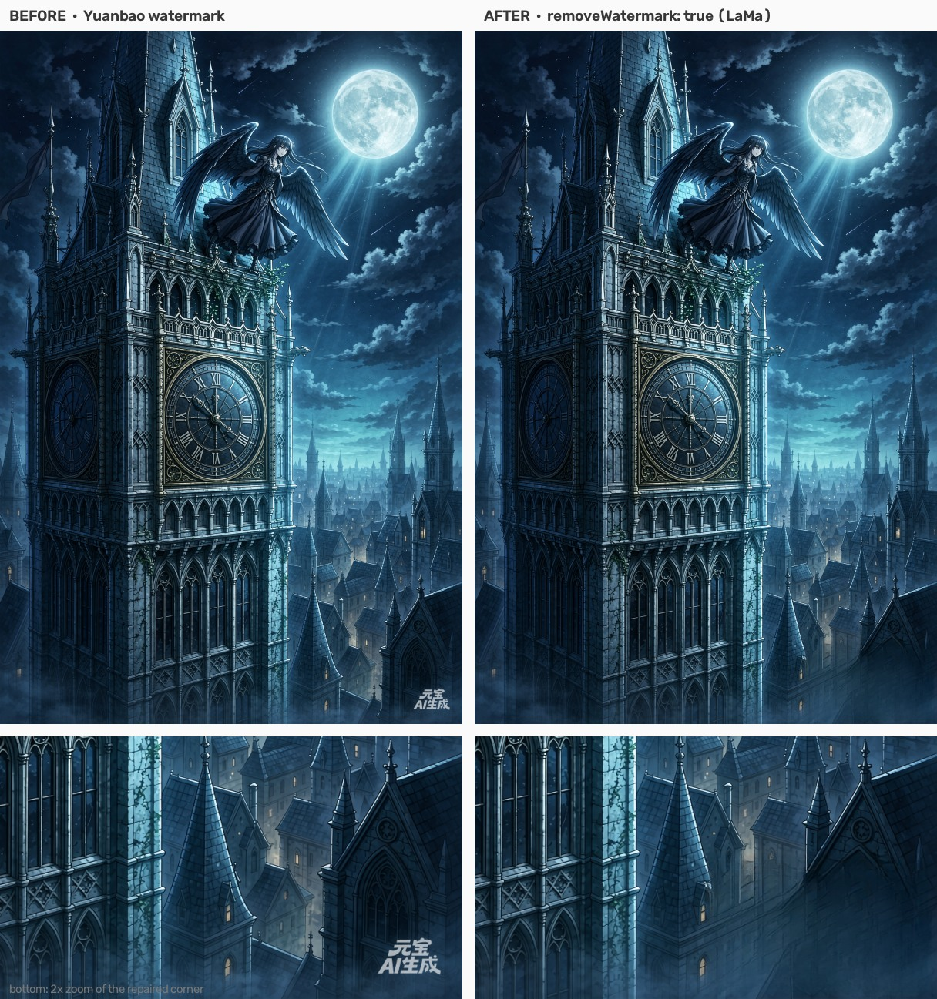
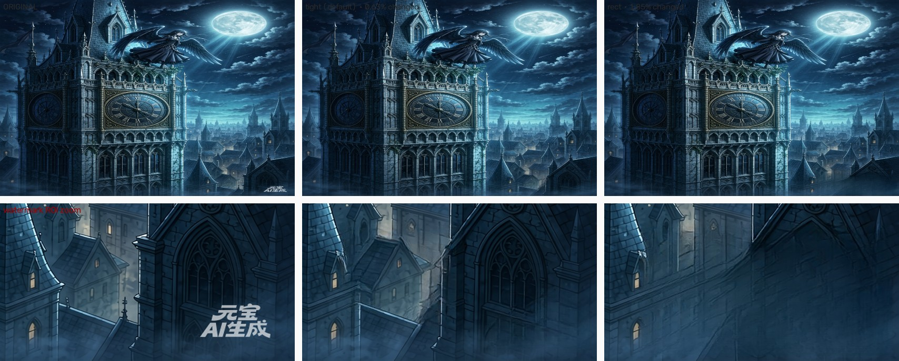

# dsh-yuanbao-t2i

[](https://github.com/lm846802297-bit/dsh-yuanbao-t2i/releases/latest)
[](LICENSE)

> 当前版本 **v0.5.1**（设置卡新增「选择目录…」按钮，调系统文件夹选择器；v0.5.0 下架 `telea` 引擎，只保留 `lama`）

[DSH](https://github.com/deepseek-ai)（DeepSeek Harness）本地插件：用**腾讯元宝网页版**（混元 Hy Image）文生图，一次 4 张 PNG 直接落盘，并可在插件设置卡里选择图片存到哪个目录（**v0.5.1 起支持点按钮选目录**，不用手敲长路径）、是否去水印、用哪个去水印引擎。

> ⚠️ **性质说明**：本插件通过 [patchright](https://github.com/Kaliiiiiiiiii-Vinyzu/patchright) 驱动真实浏览器登录元宝网页版，复用**你自己账号**的会话。请自行评估账号风险（频繁调用、自动化行为可能触发平台风控），并遵守腾讯元宝的服务条款。作者不对账号受限、图片内容或版权负责。



<sub>上半＝整图对比，下半＝右下角 2× 放大（默认 `tight` 掩膜）。默认**不去水印**；开启后可去掉右下角「元宝 AI生成」，但放大仍能看到轻微平滑／修补痕（纸纹、白底类画面更明显）——所以默认关。同图的 tight vs rect 对比见 <a href="#tight-与-rect-的差别">下节</a>。</sub>

## 它做什么

- 工具名 `yuanbao_t2i`：传中文提示词 → 弹出/复用浏览器 → 走 `yuanbao.tencent.com` 的 `/api/chat/` SSE，从 `type=replace` 帧的 `multimedias[]` 取图 → 裸 `fetch` 下载 → 落盘 PNG。
- 首次使用需**微信扫码登录**一次，登录态存在本地 profile 目录，之后复用。
- 同一个 profile 不能被两个浏览器同时打开，所以插件内部把所有调用**串行化**。
- 右下角「元宝 AI生成」水印可选去除，只用 `lama`（Big-LaMa 深度模型）。**默认不去水印**——实测 LaMa 在纸纹/白底图上仍有轻微平滑痕，看用途决定。（`telea` 引擎已于 v0.5.0 下架，理由见下文「为什么没有接入 MAT / ZITS」。）
- `lama` 的**修复范围**可选：`tight`（默认，先在 ROI 里**自适应**检出字形，膨胀后只修字形）或 `rect`（整块矩形重绘）。实测二者差别很大——`rect` 在插画上会把窗口/砖石/水彩洗边整块糊掉，`tight` 只留一道淡淡的修补痕。

## tight 与 rect 的差别

`wmMask` 只影响 `lama` 引擎重修多大一块：

| 模式 | 行为 | 实测（右图哥特城，1872×1248） |
| --- | --- | --- |
| `tight`（默认） | 在 ROI 内**自适应**检出字形（阈值由 ROI 亮度分布导出），膨胀 ~25px 后**只修字形**，再按羽化掩膜回填 | 改动 **0.63%** 像素（14,644 px）；砖缝／窗框／屋顶轮廓全部保留，只在水印原处留一道很淡的修补痕 |
| `rect` | 把 ROI 整块矩形交给 LaMa 重建 | 改动 **1.85%** 像素（43,321 px，约 3 倍）；塔身右侧一大片被抹平成雾状，窗户与尖顶细节丢失 |



**结论**：`tight` 是默认值，绝大多数图用它。只有在水印压在**高亮／近白背景**上、且 `tight` 的自适应检出判定「不可信」（两端命中面积都超 ROI 60%）自动降级 `rect` 之后，你还想手动指定行为时，才需要显式设 `rect`。

### tight 为什么能自适应

元宝水印是**半透明白**叠加：压在暗背景上是一圈**亮笔画**，压在白纸上则变成**暗笔画**（只比纸暗 3–9 个灰度级）。固定绝对阈值必然一头踩空——实测 `thr=185` 在纯白图上命中 **100%** 的 ROI，等于把整块背景当字形抹平（ROI 内 3.85%–9.51% 像素被改，文字上方的空白带 21.3% 被改）。

所以 `tight` 的阈值改由 **ROI 自身亮度分布**导出：两端各出一个候选（亮笔画 `p99.5−12`、暗笔画 `p0.5+12`），取命中面积更小的一端。16 张样本实测：

| 样本类型 | 固定 thr=185 | 自适应 |
| --- | --- | --- |
| 4 张白底宣纸图（ROI p50≈243） | 命中 97%–98%，背景被抹平 | 自动切**暗笔画**，命中 2.2%–3.0%，水印清掉、纸纹保留（背景区 std 7.99 → 7.89） |
| 4 张纯白/近白图（ROI p50≥230） | 命中 82%–100% | 命中 0.0%–2.6% |
| 8 张深底/水彩图 | 命中 0%–43% | 命中 0.6%–3.0%（无回归） |
| 全样本 ROI 平均改动面积 | 19.5% | **8.4%** |

## 示例

| 文件 | 内容 |
| --- | --- |
| [`examples/prompts.md`](examples/prompts.md) | 提示词模板：场景 BG / 角色立绘 / CG / 水彩 / 图标，含「加什么词能得到什么」对照 |
| [`examples/profile-setup.md`](examples/profile-setup.md) | 挂载到 DSH profile 的完整步骤（package.json、junction、cordis.patch.yml、验证与排错） |
| [`examples/settings.json`](examples/settings.json) | 插件设置文件（`~/.dsh/yuanbao-t2i-config.json`）示例 |

## 安装（DSH 本地插件）

插件是 DSH 的 **bundle + dual-face 包**（宿主半 `lib/plugin.js`，浏览器半 `client.js`）。装法：

1. 把本仓库放到 DSH profile 的 `vendor/` 下，例如
   `C:/Users/<你>/.dsh/profiles/desktop/vendor/yuanbao-t2i`
2. 装依赖：`npm install`（只依赖 `patchright@1.62.3`；首次运行会自行下载 Chromium）
3. 在 profile 的 `package.json` 里登记依赖与 bundle：
   ```json
   {
     "dependencies": { "dsh-yuanbao-t2i": "link:vendor/yuanbao-t2i" },
     "dsh": { "profile": { "bundles": ["dsh-yuanbao-t2i"] } }
   }
   ```
4. 把包链接进 profile 的 `node_modules`（Windows 可用 junction）：
   `mklink /J node_modules\dsh-yuanbao-t2i ..\vendor\yuanbao-t2i`
5. 重启 DSH Desktop（或在 Settings → Plugins 里把本插件关掉再打开）让它加载新的宿主半和浏览器半。

> 💡 **v0.5.1 起新增**：设置卡里「输出目录」旁边多了个**「选择目录…」**按钮，点一下弹 Windows 文件夹选择器，选完自动填进输入框（详见下文「插件界面（设置卡）」）。升级到 v0.5.1 只需 `git pull` + `npm install` + 重载 DSH，老配置文件完全兼容。

## 用法

在会话里直接让 AI 调用工具：

**文生图（Text2Image）**：
```
用元宝生图：一座哥特式教堂，雨夜，雾气，油画质感，竖构图
```

**图生图（Image2Image）**：
```
用元宝图生图：基于这张参考图，改成夜晚场景，增加雾气效果
（附上参考图路径：D:/art/scene_bg.png）
```

工具参数：

| 参数 | 类型 | 说明 |
| --- | --- | --- |
| `prompt` | string（必填） | 中文提示词，越具体越好（主体+动作+环境+风格+构图） |
| `refImages` | array[string] | 参考图路径列表（可选，≤5 张）。支持本地文件路径/URL/文件夹路径（自动遍历图片）。传了即走图生图（`dstIntent` 自动切 `Image2Image`） |
| `dstIntent` | `Text2Image` \| `Image2Image` | 生成模式（可选）。不传＝自动判断（有 `refImages` 就是 `Image2Image`，否则 `Text2Image`） |
| `imageRatio` | `16:9` \| `3:4` \| `ref:1` | 输出图片比例（可选，默认 `16:9`）。图生图时可选 `ref:1`（跟随参考图） |
| `seed` | number | 随机种子（可选，固定后可复现） |
| `outDir` | string | 保存目录；不传＝用插件界面的「输出目录」，界面留空则用默认 `~/.dsh/yuanbao-t2i-out` |
| `removeWatermark` | boolean | 是否去水印；不传＝用插件界面开关。开启后产物写 `<outDir>/clean/`，原图保留 |
| `wmEngine` | `lama` | 去水印引擎（仅去水印时生效）；当前只接受 `lama`（其余引擎均已实测下架） |
| `wmMask` | `tight` \| `rect` | 修复范围（仅 `lama` 引擎）；不传＝用插件界面设置（默认 `tight`） |

返回：图片绝对路径列表 + 原始（未去水印）路径 + 使用的参数（`refImages`/`dstIntent`/`imageRatio`/`seed`）。

## 插件界面（设置卡）

DSH **设置 → 插件 → dsh-yuanbao-t2i → 生成设置**：

- 输出目录（留空＝默认；旁边有**「选择目录…」**按钮，点击弹出 Windows 文件夹选择器，选完自动填进输入框——省得手敲长路径）
- 生成后自动去水印（开/关）
- 修复范围（只修字形 / 整块矩形；`telea` 引擎已于 v0.5.0 下架，去水印现在只走 `lama`）
- 保存

> 💡 **「选择目录…」按钮的原理**：走 DSH 宿主自带的 `window.__DSH_DESKTOP_PICK_DIRECTORY__` 桥（Windows 专属），按钮点了弹出系统文件夹选择器，返回路径填进输入框；没选定（点了取消）就保持原样。如果按钮点下去只提示「当前宿主不支持目录选择器」，说明当前宿主没装这个桥（非 Windows 或旧版 DSH），此时直接手敲路径即可。

设置存在 `~/.dsh/yuanbao-t2i-config.json`，由宿主的 `GET|POST /yuanbao-t2i/config` 路由读写（loopback only）。

## 环境变量

去水印相关的解释器/脚本默认值会自动探测，也可显式指定：

| 变量 | 作用 |
| --- | --- |
| `DSH_YUANBAO_PROFILE` | 浏览器 profile 目录（默认 `~/.dsh/yuanbao-t2i-profile`） |
| `DSH_YUANBAO_SETTINGS` | 设置文件路径（默认 `~/.dsh/yuanbao-t2i-config.json`） |
| `DSH_LAMA_PYTHON` | `lama` 引擎用的、装了 `torch` + `simple-lama-inpainting` 的 Python |
| `DSH_WM_ROI` | 水印区域 `x0,y0,x1,y1`（比例，默认 `0.71,0.878,0.992,0.996`；元宝改版面时改这个） |
| `DSH_WM_MASK` | `lama` 的修复范围（`tight` 字形 / `rect` 矩形，默认 `tight`） |
| `DSH_WM_CTX` | `tight` 送模型的上下文外扩（像素，默认 `64`；设 `0`/缺省均走默认） |

### 去水印引擎的额外依赖（可选，只在开启去水印时需要）

- `lama`：`pip install torch simple-lama-inpainting`（首次运行会下载 Big-LaMa 权重 ~196MB；有 GPU 则 GPU 推理，实测 1248×1872 单张 1–3 秒）

不开去水印则**不需要**上述任何东西，插件只依赖 patchright。

### 为什么没有接入 MAT / ZITS（2026-10-20 实测，RTX 5060 8GB）

IOPaint 的另两个主流模型都试通了，但都不比 `lama + tight` 好，故未接入：

| 引擎 | 权重 | 实测耗时 / 显存 | 改动像素占比（3 张样本均值） | 结论 |
| --- | --- | --- | --- | --- |
| `lama` + `tight`（本插件默认） | 196MB | 约 1–3 s/张 | **0.63% / 1.48% / 1.44%** | ✅ 结构全保（非水印区改动 **0.000%**） |
| MAT（Places_512） | 239MB | 1024-tile fp16 forward 1.03 s / peak 2.29GB | 2.88% / 3.32% / 2.99% | ❌ 水印区残留清晰斜向网格痕迹，塔身右侧被糊成一片 |
| ZITS（4 件套，`.pt` 非 `.pth`） | 373 MiB | 全图 fp16 infer 2.88 s/张（加载 0.71 s）/ peak 6.09 GB；CPU 19.85 s/张 | 4.76% / 3.74% / 3.68% | ❌ 非水印区也被改 0.234%，水印区洗成大片浅灰雾状 |

- 三家的掩膜都是**同一块矩形**（`x 0.679–1.0, y 0.86–1.0`）⇒ 差异全来自模型本身，可比。
- MAT 是 **512 定频模型**：输入必须是 512 的倍数（2048 会 OOM），所以走「右下 1024×1024 tile 推理后贴回」；ZITS 可全图直接跑但显存吃满 6GB。
- ZITS 必须设 `PYTORCH_CUDA_ALLOC_CONF=expandable_segments:True`，否则 OOM（根因：ZITS 把图 pad 成正方形，1872×1248 → 1888×1888，面积 ×2.26 再跑四阶段）；其 LCNN wireframe `.pt` 权重导出时把设备烤死为 CPU，**只能在 CPU 跑**。
- ZITS 在本机 default env **零新装依赖**（torch 2.14.0+cu130 / cv2 5.0 / numpy 2.5.3 / skimage 0.26.0 全就位）；CUDA vs CPU 结果 maxdiff 6 / mean 0.023，数值等价。完整实测报告：`IOPaint 实测` 的本地副本见会话记录。
- 结论：**`tight` 掩膜 + Big-LaMa 是当前性价比最优解**——改动面积只有 MAT/ZITS 的 1/4~1/7，且是唯一不在水印区外留痕的。若未来元宝水印改成**非近白配色**（tight 的字形检出会失效），再考虑 MAT/ZITS 作 `rect` 的备选。

### 为什么只剩 `lama` 一个引擎（v0.5.0 下架 `telea`）

`telea`（OpenCV TELEA）曾作为「没装 torch 时的降级档」保留，v0.5.0 下架，三个原因：

1. **质量明显低于 `lama`**：经典扩散修复高频纹理会留下涂抹痕，插画类尤其明显——本插件主要服务的正是插画 / CG / 立绘场景。
2. **接线成本不成比例**：它要外挂一个**仓库之外**的 `clean_watermark.py` + 一个装了 `opencv-python` 的独立解释器（曾靠扫 `~/.dsh/skills` 与 `~/Desktop/*` 才找到脚本），而插件主功能（生图）本身已依赖 patchright + Node，再为去水印降一档没有意义。
3. **速度不构成理由**：`lama` 在 GPU 上 1248×1872 单张 1–3 秒（tight 裁切后远低于此），比 telea 慢不了多少。

⇒ 现在去水印是**单一引擎**：`pip install torch simple-lama-inpainting` 即可，无第二个解释器、无外部脚本。

**补充（2026-10-20 实测追加）**：ZITS 的文字擦除确实比 `tight` + LaMa 更干净——水彩图的「暗像素残留」从 tight+LaMa 的 **2523** 降到 ZITS 的 **15**；但代价是纹理被糊掉一个量级：

| 指标 | orig | `tight` + LaMa | ZITS |
| --- | --- | --- | --- |
| 水彩图「暗像素残留」 | — | 2523 | **15** |
| ROI 顶部 25px 拉普拉斯方差 | 1043–1369 | 695–1349 | **108–566** |
| ROI 外 40px 结构带 mean | — | **0.00**（`tight` 完全不动水印框外像素） | 5.1–7.8 |

⇒ **ROI 外 40px 结构带、文字残影这两项，ZITS 赢在「擦得干净」、输在「糊掉纹理」**，与上面结论一致 ⇒ **仍不建议接入**。

**什么时候值得回头用 ZITS（诊断口径，2026-10-20 补）**：ZITS 唯一的真实优势是「文字擦得干净」——ROI 内暗像素残留只有 tight+LaMa 的 1/168（15 vs 2523）。如果未来遇到**同时满足**这三条的场景，值得重新评估接入：
1. 水印压在**高频纹理**上（砖缝 / 瓦檐 / 水彩纸纹），而 `tight` + LaMa 留下**可读的残影**；
2. 该纹理**糊掉一个量级**造成的损失 < 残影造成的损失（例：纹理只是背景陪衬，而水印文字挡住画面主体）；
3. 显存够跑（8GB 卡需 `PYTORCH_CUDA_ALLOC_CONF=expandable_segments:True`，峰值 6.09GB）。

反之——**纹理本身是画面主体**（本插件默认服务的插画 / CG / 立绘场景）——ZITS 是净负优化：LaMa 保留的 ROI 拉普拉斯方差 695–1349 vs ZITS 108–566。

## 已知限制

- 一次固定 4 张图，尺寸随元宝返回（实测 1248×1872 / 1344×1792），单张 3MB 左右。
- 水印 ROI 按 2026-10 的版面量得（默认 `x 0.710–0.992, y 0.878–0.996`，只包住文字本体）；元宝改版面后需重新量，或用环境变量 `DSH_WM_ROI` 覆盖。
- `tight` 掩膜默认走自适应阈值（亮/暗笔画二选一），但**极端画面仍可能失效**：水印与背景亮度差小于 3 个灰度级时无法分离；两端命中面积都超 ROI 60% 时自动降级 `rect`（重修面积变大）。可用 `wmMask: "rect"` 强制整块重绘，或调 `DSH_WM_ROI`。
- **水彩 / 中灰背景图上 `tight` 可能漏字**（2026-10-20 实测）：元宝水印是半透明灰字，在中灰水彩底上与背景亮度差 < 15 灰度级且分布几乎完全重叠 ⇒ 逐像素阈值原理上不可分，掩膜可能整块落在背景纸纹上而水印文字残留。已试过 blackhat / 局部差 / adaptiveThreshold / 行投影+列峰等结构先验方案，16 张样本上均不能可靠定位文字行（暗底图文字区反差能量仅为背景的 1.5–2.3 倍，信号弱于纸纹）⇒ 未接入。遇到这类图请改用 `wmMask: "rect"`（整块重绘，不会漏字但重修面积大）。
- **图生图（refImages）已支持**，但**元宝前端可能不识别 `window.__YUANBAO_PENDING_IMAGES__` 注入的参考图**（当前实现假设前端会读取该变量并与 prompt 一起发送）。如果实测元宝不识别，需要改成走官方 API（genUploadInfo + COS 上传 + TIMImageElem 直接 POST 到 `/api/chat/`）。
- LaMa 修复在白色背景 + 细纸纹图上仍可能留下轻微平滑痕——这也是「默认不去水印」的原因。

## License

MIT
